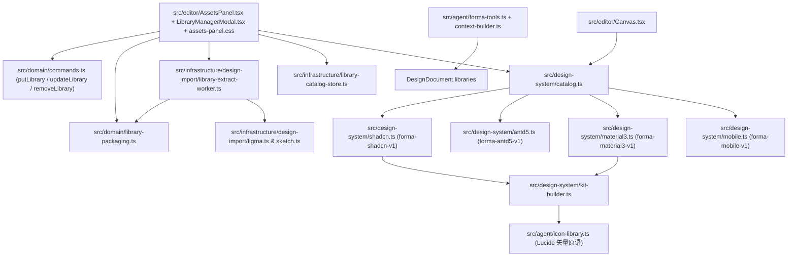

# 工程设计 · 资源面板一致性重构与成熟组件库管理体系

- **课题编号**：`2026-11-25-assets-and-library-manager`
- **状态**：已定稿，待施工
- **最后更新**：2026-11-25
- **关联文档**：[PRD.md](PRD.md) · [TASKS.md](TASKS.md) · [ARCHITECTURE.md](../../ARCHITECTURE.md)

---

## 一、分层架构设计

严格遵守 `src/domain`（纯领域与事务，零 React/DOM/IO）→ `src/design-system`（内置设计体系与目录）→ `src/infrastructure`（本地 IndexedDB 仓库与离线 Worker）→ `src/editor`（面板与管理弹窗）→ `src/agent` / `src/compiler`（AI 工具与 React 编译）单向依赖规则：



---

## 二、精确模块与接口契约

### 1. 内置组件库共享原语与 4 大体系（`src/design-system/`）

#### 1.1 `src/design-system/kit-builder.ts`
提供零 React 依赖的轻量组件构造器 `KitBuilder`（供 `material3.ts`、`shadcn.ts` 复用），能力：
- 自动维护根 `frame`（`templateKey: "root"`）、子节点唯一 `id`/`templateKey`、`box()`、`frame()`（支持 `layout: "horizontal" | "vertical"`、`padding`、`gap`、`alignX`/`alignY`）、`text()`、`pill()`、`lucideIcon(key, iconName, x, y, size, color, strokeWidth?, parent?)`（从 `src/agent/icon-library.ts` 的 `iconToFormaVector` 直接生成精准矢量路径，找不到图标时回退内置简洁路径，保证永不抛异常）、`control()`。
- 通用变体笛卡尔积工具 `combinations(axes)` 与 DesignSystem 语义变量集合生成器 `createAppearanceSystem(collectionId, collectionName, prefix, lightPalette, darkPalette)` 及自动节点绑定器 `bindPaletteVariant(nodes, collectionId, prefix, lightPalette, darkPalette, appearance)`。

#### 1.2 三套新增内置库统一导出契约
每套内置库文件（`material3.ts`、`antd5.ts`、`shadcn.ts`）均遵循完全一致的导出结构，全部通过 `parseLibrary(...)` 启动校验：
- **常量 ID**：
  - `MOBILE_LIBRARY_ID = "forma-mobile-v1"`（既有，保持不变）
  - `MATERIAL3_LIBRARY_ID = "forma-material3-v1"`
  - `ANTD5_LIBRARY_ID = "forma-antd5-v1"`
  - `SHADCN_LIBRARY_ID = "forma-shadcn-v1"`
- **导出符号**（以 `<kit>` 为前缀）：
  - `<kit>Library: ComponentLibrary`（`format: "forma/library"`, `version: 1`, `revision: 1`, 自带 Light/Dark `designSystem` 语义变量集合）
  - `<kit>Tokens: Record<string, { name: string; value: string }>`（键名含 `light` / `dark`，供「添加颜色到文件」与「规范」展示）
  - `<kit>Typography: readonly { name: string; size: number; lineHeight: number; weight: number }[]`
  - `<kit>Spacing: readonly { name: string; value: string; kind: "radius" | "spacing" }[]`
  - `<kit>Templates: readonly BuiltinTemplateMeta[]`
  - `create<Kit>Template(doc: DesignDocument, templateId: string, appearance: Appearance, origin: Point): { operations: Operation[]; id: string }`

#### 1.3 `src/design-system/catalog.ts`
统一内置目录注册表（SSOT）：
```ts
export type LibraryPlatform = "ios" | "android" | "web-enterprise" | "web-modern";

export interface BuiltinFoundationToken {
  id: string;
  label: string;
  fullName: string;
  value: string;
}

export interface BuiltinTypographySpec {
  name: string;
  size: number;
  lineHeight: number;
  weight: number;
}

export interface BuiltinScaleSpec {
  name: string;
  value: string;
  kind: "radius" | "spacing";
}

export interface BuiltinTemplateMeta {
  id: string;
  libraryId: string;
  name: string;
  description: string;
  width: number;
  height: number;
  platform: LibraryPlatform;
}

export interface BuiltinLibraryEntry {
  id: string;
  name: string;
  shortName: string;
  platform: LibraryPlatform;
  platformLabel: string;
  accent: string;
  swatches: readonly string[];
  summary: string;
  defaultEnabled: boolean;
  library: ComponentLibrary;
  tokens: Record<string, { name: string; value: string }>;
  getAppearanceTokens: (appearance: Appearance) => BuiltinFoundationToken[];
  typography: readonly BuiltinTypographySpec[];
  scales: readonly BuiltinScaleSpec[];
  templates: readonly BuiltinTemplateMeta[];
  createTemplate: (
    doc: DesignDocument,
    templateId: string,
    appearance: Appearance,
    origin: Point,
  ) => { operations: Operation[]; id: string };
}
```
导出：`BUILTIN_LIBRARIES`、`BUILTIN_TEMPLATES`、`DEFAULT_ENABLED_BUILTIN_IDS`（`[MOBILE_LIBRARY_ID]`）、`findBuiltinEntry(id)`、`findBuiltinLibrary(id)`、`createBuiltinTemplate(...)`。

---

### 2. 领域事务与组件库打包内核（`src/domain/`）

#### 2.1 `src/domain/commands.ts` 新增 `removeLibrary` 事务
```ts
z.object({ type: z.literal("removeLibrary"), libraryId: z.string().min(1).max(128) })
```
执行规则：
1. 若 `next.libraries?.[op.libraryId]` 不存在，静默跳过或无副作用继续（幂等安全）。
2. 全量扫描 `next.nodes` 与 `next.pages[].nodes` 中所有带 `node.instance` 的图层，通过 `referencedComponents(node.instance)`（覆盖直接实例与嵌套槽位引用）统计引用 `op.libraryId` 的实例数 `count`。
3. 若 `count > 0`，抛错：`仍有 ${count} 个画布实例正在使用此组件库，请先分离或删除相关实例后再移除`。
4. 若 `count === 0`，从 `next.libraries` 删除 `op.libraryId`（若 `libraries` 为空则 `delete next.libraries`），随事务递增 `revision`，天然支持 `⌘Z` 单步撤销还原。

#### 2.2 `src/domain/library-packaging.ts`
纯领域函数，无 DOM/存储依赖：
- `countLibraryInstances(doc: DesignDocument, libraryId: string): number` — 跨全部页面统计引用某库的实例总数（含嵌套槽位）。
- `allLibraryInstanceCounts(doc: DesignDocument): Record<string, number>` — 一次性 O(N) 统计当前文档所有已安装库的引用计数，供 UI 零卡顿展示。
- `packageDocumentAsLibrary(doc: DesignDocument, options: PackageLibraryOptions): ComponentLibrary` — 将当前文档的本地主组件（`localMasters(doc)`）或指定的 `componentRefs`（支持汇总多个自定义库或已导入 `.fig`/`.sketch` 组件）合并打包为一份合法自包含 `forma/library` v1 快照：
  - 自动去重 `component.id`（冲突时加后缀）；
  - 剥离仅限源文档的 `master` 指针（设为便携共享快照，避免跨文件误认本地主件）；
  - 通过 `libraryDesignSystem`、`libraryFonts` 与节点 `image.assetId` 仅携带实际引用的变量/样式/字体/位图；
  - 强制经 `parseLibrary(...)` 校验返回。
- `extractLibrariesFromDocument(doc: DesignDocument, options?: { name?: string; sourceName?: string; license?: string }): ComponentLibrary` — 从已解析的 `.fig` / `.sketch` / `.forma` 文档中提取全部可复用组件合并为一份标准 `ComponentLibrary`（若文档存在多个子库则合并组件与依赖资产；若无任何组件则抛明确中文提示 `此文件不包含可提取的组件或符号定义`）。

---

### 3. 本地持久化与离线提取 Worker（`src/infrastructure/`）

#### 3.1 `src/infrastructure/library-catalog-store.ts`
1. **按文档启用的内置库集合**：
   - 存储键：`forma-enabled-builtin-libs:<docId>`（`localStorage`，带 try/catch 兜底）。
   - `getEnabledBuiltinLibraries(docId: string, docLibraries?: Record<string, ComponentLibrary>): string[]`：
     - 若未自定义过，默认返回 `[MOBILE_LIBRARY_ID]` 加上 `docLibraries` 中已安装的其他内置库 ID；
     - 若用户已显式配置，返回持久化列表与 `docLibraries` 中当前已安装的内置库并集（或允许明确记录“已停用”状态，以 `stored` 为准，仅首次打开含某内置库的历史文件时自动纳入）。
   - `setEnabledBuiltinLibraries(docId: string, ids: string[]): string[]`：去重并过滤有效内置库 ID 后持久化。
2. **工作区跨文件自定义组件库仓（Workspace Library Catalog）**：
   - IndexedDB 数据库名 `forma-workspace-libraries-v1`，objectStore `libraries`（keyPath `id`），单条记录保存 `{ id, name, revision, savedAt, sourceKind: "json" | "figma" | "sketch" | "packaged", componentCount, variantCount, library: ComponentLibrary }`。
   - 在无 IndexedDB 环境（如 Node 单测或隐私受限模式）自动降级为内存 Map（小快照可选降级），绝不崩溃。
   - 导出异步 API：`listWorkspaceLibraries()`、`saveWorkspaceLibrary(lib, sourceKind)`、`deleteWorkspaceLibrary(id)`。

#### 3.2 `src/infrastructure/design-import/library-extract-worker.ts`
独立 Web Worker（完全不改动既有 `worker.ts`）：
- 接收 `File` 对象，复用 `checkDesignFileSize`、`figmaHeader`、`openDesignArchive`、`importSketch`、`importFigma`、`parseDocument`、`extractLibrariesFromDocument`。
- 分阶段回传 `{ stage: string }`，完成后回传 `{ library: ComponentLibrary, format: "Figma" | "Sketch", componentCount: number, variantCount: number, issueCount: number }` 或 `{ error: string }`。
- 严格 100% 离线，零网络请求，保留 `checkDesignFileSize` 与 `parseLibrary` 安全上限（单库 ≤ 50,000 图层 / ≤ 4,096 组件）。

---

### 4. 资源面板重构与组件库管理中心 UI（`src/editor/`）

#### 4.1 彻底修复图 1 的布局与样式根因
1. **父级高度契约**：在 `App.tsx` 给 `.sidebar-content` 增加 `assets-sidebar` 类（当 `tab === "assets"`），在 `ui3-theme.css` / `assets-panel.css` 设置：
   ```css
   .sidebar-content.assets-sidebar {
     display: flex;
     flex-direction: column;
     overflow: hidden;
   }
   .assets-panel {
     display: flex;
     flex-direction: column;
     flex: 1;
     min-height: 0;
     height: auto;
     overflow: hidden;
   }
   ```
   彻底移除错误的 `height: calc(100% - 64px)`，使底栏 `.milestone` 精准贴底，滚轮仅滚动 `.assets-list`。
2. **消除 Grid 幻影空白**：`.assets-list` 改为 `display: flex; flex-direction: column; gap: 12px; padding: 10px; overflow-y: auto;`。
3. **统一 UI3 控件体系（`src/editor/assets-panel.css`）**：
   - 全量使用 `--bg-panel` / `--bg-panel-alt` / `--bg-input` / `--bg-hover` / `--border-subtle` / `--text-primary` / `--text-secondary` / `--text-muted` / `--figma-blue` / `--figma-purple`，**零硬编码浅色色值**；
   - **规范页签（Foundations）**：
     - 粘性顶栏增加「体系切换（4 套内置库）」+「浅色 / 深色」双控件（统一 `26px` 高度），底边 `1px solid var(--border-subtle)` 清晰隔断滚动区；
     - 「语义颜色」小节头右侧提供紧凑 `+ 添加到文件` 按钮（保留「添加颜色到文件」无障碍名），下方 `.token-row` 固定 `height: 28px`、`gap: 2px`、`padding: 0 6px`、`border-radius: 6px`，色块 `16×16px` 带 `inset 0 0 0 1px rgba(128,128,128,0.22)`，右侧等宽 `tabular-nums` HEX；点击色卡若当前有选区则直接应用填充/文字色，否则复制 HEX 并短暂显示 `已复制`；
     - 「文字层级」小节采用 `border-top: 1px solid var(--border-subtle)` 分隔，每行 `.type-spec` 固定紧凑节奏（左预览字号收敛至 `11–16px`，右等宽规格 `34/41 · 700`），点击可在选中文本层时应用排版或在画布插入样例文本；
     - 新增「圆角与间距」胶囊矩阵与「本文件颜色」独立小节（同款 28px `.token-row`）；
   - **页面页签（Templates）**：支持按体系筛选全部 10 套模板，重构 `.template-card` 适配深浅双主题；
   - **基础元素折叠区（`.basic-assets`）**：取消双层 `padding: 12px`，左右边距与上方内容严格齐平；5 个基础元素按钮改用 `30px` 高紧凑双列 UI3 按钮配 Lucide 线形图标（`Frame / Square / Circle / Type / MousePointerClick`）；不再把文件颜色塞在按钮下方黏连显示。
4. **组件库管理中心（`src/editor/LibraryManagerModal.tsx`）**：
   - 顶栏与工具条新增「组件库管理」按钮（带已启用库计数徽标，`aria-label="组件库管理"`，`data-tip="组件库管理"`，`data-tip-kbd="⌥3"`），并保留既有 `保存选区`、`在线组件库`、`导入组件库`、`供 Agent 使用` 按钮与隐藏 `.json` 文件输入框；
   - 弹窗分三页签：`官方体系`（4 套内置库卡片 + 色板条 + 组件/变体/模板统计 + 启用开关 + 查看规范/导出）、`本文件与自定义`（当前已安装库列表含实例引用计数、安全卸载、导出/发布、导入 `.forma-library.json`、从 `.fig`/`.sketch` 离线提取建库、打包当前文档主组件为库、工作区跨文件保存库一键启用）、`在线订阅`（整合团队 HTTP 订阅与版本更新检查）。

---

### 5. 画布拖放与 AI Agent 联动

1. **`src/editor/Canvas.tsx`**：`onDrop` 处理 `application/x-forma-asset` 时，优先取 `current.libraries?.[parsed.libraryId]`，未安装时回退查 `findBuiltinLibrary(parsed.libraryId)`（不再硬编码 `MOBILE_LIBRARY_ID`）。
2. **`src/agent/forma-tools.ts` & `src/agent/context-builder.ts`**：
   - `list_components` 与上下文摘要清晰透出所有已启用/已安装组件库的 `id`、`name`、`revision`、分类、组件与变体列表；
   - 当文档未注册任何库或仅注册单个库且用户检索不到目标平台组件时，工具结果附带友好提示（告知可在「资源 → 组件库管理」中一键启用 iOS / Material Design 3 / Ant Design 5 / shadcn/ui，不静默联网、不越权修改文档）。

---

## 三、安全红线与兼容边界

1. **零静默外网请求**：4 套内置库全部静态打包本地可用；`.fig`/`.sketch` 提取 Worker 纯离线运行；仅在用户主动输入团队地址订阅或发布时发起明确校验的 HTTP(S) 请求。
2. **实例保护不妥协**：`removeLibrary` 强校验跨页直接与嵌套实例引用，有引用时拒绝事务；所有启用、安装、更新、卸载操作均经 `transact()` 原子执行，支持 `⌘Z` 完整撤销。
3. **测试与旧文件 100% 兼容**：`schemaVersion: 1` 不变；`forma-mobile-v1` ID/组件/变体不变且默认启用；所有既有 374 项单测与既有 Playwright E2E 脚本无需降级或跳过。
