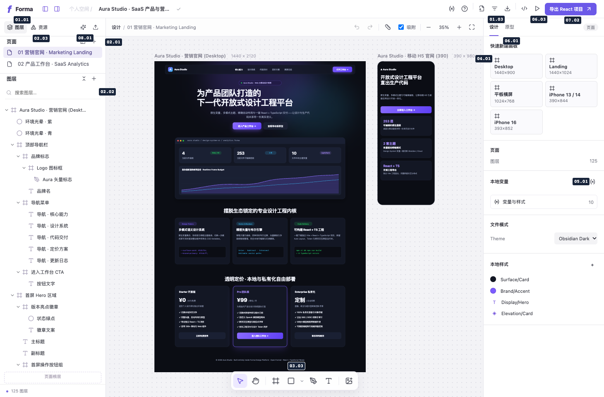

# Forma 与 Figma 功能面板编号及用户验收

最近更新日期 2026-11-22 · Forma 0.6.5（增量演进 61 面板与多模型画布对话） · 状态 **已实施并验收**（限各编号列出的操作；最右列记录界面差异及能力边界）

关联源码 [编辑器](../../src/editor/)、[播放器](../../src/runtime/)、[工程交付](../../src/compiler/)、[桌面窗口](../../electron/)。

编号对应用户可以找到的面板、浮层或上下文工具。先按编号找到入口，再照该行的动作核对结果。Web 和 Mac 两列表示在 Chrome 网页编辑器及 Apple Silicon 安装包上分别完成整行操作。证据名对应文末的实测记录。未观察到结果就保留待验。

Figma 侧使用单独的新建草稿，现场查看 File、Pages、Layers、Agents、画板预设、空选区的 Design、Prototype、Styles、Export 和底部工具栏，并新增第二页。每组下列出 Figma 官方操作说明作为其余交互的对照依据。Figma 云端库发布和收费功能没有在该草稿执行。Forma 侧从实际界面打开、操作、保存、重开、预览及下载。截图保留操作后的界面。原交接工作区无 Git 元数据，Gemini 的交付按可复现行为核对，无法按作者拆分。

[Figma 草稿界面](../evidence/2026-11-20/panels/figma-draft.png) · [Figma 画板预设](../evidence/2026-11-20/panels/figma-presets.png) · [真实控件读数](../evidence/2026-11-20/panels/figma-presets.txt) · [指定参考文件的图层栏](../evidence/2026-11-20/figma-sidebar.png)

**历史基线**　0.6.0 的 49 个编号已通过双端操作验收。0.6.1 新增 01.06，分别在 Chrome 和 macOS 安装包通过，原有编号沿用各自注明的验收版本。Mac 使用安装包的离屏渲染窗口，按下、拖动、输入、关闭和下载均从产品入口执行。按端保存的原始实测结果列在文末。

0.6.0 的历史入口图如下，0.6.2 的实拍见下节。

## 2026-11-22 · 61 面板补齐与多模型画布对话验收

本次按 Figma UI3 逐项复核已有 50 个面板并补齐 **11 个缺失核心面板/工具**（编号扩展至 **61 个**：新增 `03.08–03.11`、`04.20–04.22`、`06.04`、`07.04`、`08.03–08.04`），同时落地 13 家主流大模型「供应商 + Key」自动适配与画布内联对话生成（详见[多模型自动适配与画布对话设计规格](AGENT-PROVIDER-AND-CANVAS-CHAT.md)）。

- **既有 50 面板深度对齐增强**：`01.05` 增加 Copy as CSS/SVG、包裹分区、选择匹配图层与 Ready for dev；`02.02` 增加分区/切片图标、DEV 徽标与选择匹配图层（`⌥⌘A`）；`03.03` 底部悬浮工具栏按 Figma 分组（Move/Scale/Hand、Frame/Section/Slice、Shapes、Pen/Pencil、Text、Comment、Image/SVG、AI 对话、Dev Mode `</>`）；`04.01` 折叠式画板预设补齐 Watch / Paper / Social media；`04.07` 增加圆角平滑；`04.08` 补齐角度（Angular）与菱形（Diamond）渐变；`04.09` 增加 WCAG 2.1 对比度分析；`04.14` 补齐 90° 旋转、曝光/色温/色调/高光/阴影调色与四边四角裁切手柄；`05.01` 补齐多平台 Code Syntax（Web/React/iOS/Android）与 Scopes；`06.02/06.03` 补齐单图层多触发交互、Smart Animate 与设备机身框。
- **实拍证据（2026-11-22 Retina 2×，Chrome）**：[深色工作区](../evidence/2026-11-22/v0.7.0/01-dark-workspace.png) · [视图选项菜单](../evidence/2026-11-22/v0.7.0/02-dark-view-options.png) · [开发检查模式 Dev Mode](../evidence/2026-11-22/v0.7.0/03-dark-dev-mode.png) · [设计规范校验](../evidence/2026-11-22/v0.7.0/04-dark-design-lint.png) · [多模型供应商配置](../evidence/2026-11-22/v0.7.0/05-dark-model-config.png) · [自动探测与能力画像](../evidence/2026-11-22/v0.7.0/06-dark-model-detected.png) · [画布内联对话实时预览（深色）](../evidence/2026-11-22/v0.7.0/07-dark-canvas-ai-preview.png) · [画布内联对话实时预览（浅色）](../evidence/2026-11-22/v0.7.0/08-light-canvas-ai-preview.png)

## 0.6.5 文字编辑补验

**03.05、04.13**　双击已有图层或用键盘进入编辑时，固定尺寸、Hug、居中折行、底部对齐及嵌套旋转图层的文字保持原位。按显示、双击、提交的顺序测每个字符的屏幕矩形，并在三档缩放逐像素比较正文。[复现图层与实测](../EDITOR-ACCEPTANCE.md#065-文本图层原位编辑)

## 0.6.4 位图与输入补验

- **04.14、04.16、07.02**　可在画布拖动裁切，单步撤销，切换平铺、改倍率、调节亮度/对比度/饱和度。对普通填充、Alpha 和亮度蒙版分别取样，并验证 SVG、PNG 和独立 React 工程。
- **06.02、06.03**　鼠标悬停、触摸点击、Tab/Shift+Tab、Enter/Space 和 Esc 分别从实际控件进入。打开两层浮层并返回，步进器增加按钮重新获得焦点。触摸采用浏览器仿真，Mac 安装包执行鼠标与键盘路径。

[可重开的设计文件、工程与测量](../EDITOR-ACCEPTANCE.md#064-位图编辑与原型输入)

## 0.6.3 布局面板补验

04.04 补测截图中的纵向布局。0.6.2 的换行用例验证了子层位置，却漏掉了矩阵和输入框在属性栏内的排布。0.6.3 已在同一画板逐项检查间距同行、独立边距两行、九点的选中状态以及短窗口的滚动。[修复前后与四端复验](../EDITOR-ACCEPTANCE.md#063-属性栏布局)

## 0.6.2 独立复核

逐项对照 Gemini 的 50 行原始报告、Figma 草稿实拍、当前工作区及正式构建。最右列给出每个编号在本版实际达到的行为与差距。网页与 Mac 的通过标记只对应同一行的“复验操作”；最右列还包含源码核对和视觉观察。原始报告中的 18 组问题有多项集中在同一编号，不能用 18 或 50 作视觉完成率的分母。本版专项从文件列表改名、真实资源拖放、松手后撤销、点击原型曲线和重开样式等入口取证。[本版记录](../EDITOR-ACCEPTANCE.md#062-面板复核) · [分平台结果](../evidence/2026-11-21/v0.6.2/results.json)

最近一次 Forma 主界面与变量窗口实拍可直接同上方 Figma 草稿对照。两边的文件内容、视口与产品语言不同；本轮几何和像素测量使用 Forma 自身画布、预览和独立网页工程。[桌面深色](../evidence/2026-11-21/v0.6.2/editor-dark.png) · [桌面浅色](../evidence/2026-11-21/v0.6.2/editor-light.png) · [721×480](../evidence/2026-11-21/v0.6.2/compact.png) · [变量窗口](../evidence/2026-11-21/v0.6.2/variables.png)

### 同状态的视觉对照

两端打开空白文件，比较深色界面下的无选区与画板工具状态。Figma 的原始位图是 3062×2020，含桌面标签栏；Forma 视口为 1531×972 CSS px，以 2 倍分辨率截图。下表的 Figma 宽度是依据区块分界读取的近似值，Forma 尺寸来自浏览器布局。[Figma 空白稿](../evidence/2026-11-20/panels/figma-draft.png) · [Forma 空白稿](../evidence/2026-11-21/v0.6.2/blank-design.png) · [Figma 画板工具](../evidence/2026-11-20/panels/figma-presets.png) · [Forma 画板工具](../evidence/2026-11-21/v0.6.2/blank-frame-tool.png) · [布局读数](../evidence/2026-11-21/v0.6.2/blank-layout.json)

| 可核查项目 | Figma 参考 | Forma 0.6.2 |
| --- | --- | --- |
| 左侧导航和面板 | 纵向导航约 57 px，左侧总宽约 298 px | 48 px 导航，左侧总宽 296 px |
| 画布与面板底色 | 画布 #1E1E1E，图层面板 #2C2C2C | 两处像素读数相同 |
| 空选区与 F 工具 | 空选区显示 Page、Styles、Export；F 显示预设 | 空选区显示页面背景、本地变量和样式；F 显示分类预设。图层切图入口在对象右栏，整文件工程导出在顶栏 |
| 顶部与右侧 | 文件名在左栏，播放/分享在右上；右栏约 240 px | 40 px 文件栏、32 px 画布栏，右栏 292 px。工程交付、本地文件和画布视图保留现有入口 |
| 底部创作工具 | 浮动条位于画布底部 | 浮动条位于画布底部；工具数量和可用模式见 03.03 |

复核输入为 Gemini 的 `figma-alignment-audit-and-plan.md`，SHA-256 为 `930ddac2d68db314e854bc1e272af318b0ac6ca644880c44d87598b8426793e0`。下列本版专项能复验原清单中最容易损坏文档或误判为完成的交互。

| Gemini 原报告问题号 | 本版核查入口 | 能直接观察到的结果 |
| --- | --- | --- |
| 1–7、15–16 | `panel-data-safety`、`editor-panels`、`vector-network`、`guides` | 顶层排在树首。↓ 切行不移动画布节点。不同数值及不同文字失焦后保留各自内容。文本按 Esc 提交且一次撤销还原。四角实际 CSS 半径按物理位置为 4/8/12/16 px。新钢笔草稿退至空后继续撤销，之前的文档修改保留。 |
| 8–11 | `panel-parity`、`mixed-materials`、`canvas-component-set`、`panel-gestures`，另见 `phase1-fixes.test.ts` | 颜色与透明度同次提交。两种透明度的对象批量改色可整体撤销。位图上方的多层填充有渲染验证。组件集可编辑；锁定画板后样式、圆角和视口宽度控件禁用。 |
| 12–14、17–18 | `panel-dialogs`、`panel-gestures`、`panel-parity`、`mcp`、`library-tokens`、`keyboard-authoring` | 在样式详情修改渐变及叠加填充，应用后刷新能看到两种颜色。变量浮窗打开仍可在画布用 F。两个不同资源连续拖入成功。切换至图层再返回，草稿和外部配对保留。 |

## 2026-11-21 复核与 Figma UI3 对齐

以下保留 0.6.1 阶段记录，0.6.2 已修订其结论。

**原交付结论**　按编号逐项读源码并从界面复现，2026-11-20 的「已对齐」只覆盖表内操作。布局、视觉样式和部分交互与 Figma UI3 仍有差距，另复现 18 个 P0 缺陷（如图层树 Z 序与 Figma 相反、8 位 HEX 丢失透明度、0 组件库无法更新、静态 SVG 导出丢失逐路径颜色、行内文本 Esc 丢稿、矢量编辑 ⌘Z 失效）。该阶段交付了 UI3 外观及对应修复。0.6.2 另发现颜色拖动的最终提交、样式详情、助手会话以及部分锁定控件仍需修正，详见各编号最右列。

**已实现（Chrome 网页编辑器验收）**

| 范围 | 对照 Figma UI3 的具体项 |
| --- | --- |
| 全局主题 | 深色默认、浅色可切换（`forma.ui-theme` 持久化）；语义色 Design Blue `#0D99FF`、组件 Purple `#9747FF`、辅助线/测量 Red `#F24822`、Dev Green `#14AE5C`；40 px 顶栏、32 px 画布栏、高密度自绘 select/checkbox/range。主题规则仅作用于编辑器外壳，`.canvas-world` 与 `.runtime-stage` 不受影响。 |
| 01.01–01.06 | 分组文件菜单（图标与 `<kbd>`、⌘S）；740 px 网格/列表文件浏览器及改名删除；操作搜索 `aria-activedescendant` 与英文关键词；快捷键改为底部分类抽屉；右键菜单悬停级联、动态显隐/锁定、转到主组件；颜色配置加关闭按钮和 P3 硬件提示。 |
| 02.01–02.07 | 页面栏可折叠、可拖高、悬停操作、右键菜单与拖放指示；图层树 Z 序与 Figma 一致（顶层在上）、行高 26 px、类型筛选、锁在眼前、锚点优先的 Shift 区间、方向键导航；资源两列网格/列表、可拖到画布；发布地址持久化与复制；760 px 库审阅含全部解决与受影响实例。 |
| 03.01–03.07 | 页面背景着色、组件选区紫色、单像素屏幕空间选区框和角外旋转柄；Alt 悬停四边距、Alt 从中心绘制及 `W×H` 读数；双击画板标签改名；缩放预设菜单；标尺纵向文字旋转。 |
| 04.01–04.19 | 页面背景（含可见性）与分类画板预设；`W/H/X/Y` 字母标签；旋转 `°` 与旋转 90°；可点击约束图；绝对定位；`space-between`；`pass-through` 混合；描边可见性、单边与虚线；逐个阴影/模糊可见性；文字斜体/下划线/删除线/大小写及「…」详情（垂直对齐、尺寸模式、最大行数）；选区颜色覆盖渐变、矢量与富文本；底部导出 PNG/JPEG/WebP/SVG @1x/2x/3x。 |
| 05.01–05.03 | 变量窗口改为可拖动、非模态；样式按 `/` 分组；新建样式入口。 |
| 06.01–06.03 | 蓝色连线与画布 ▶ Flow 徽标；触发 click/hover/delay；打开链接动作；instant/dissolve/move-in/push/slide-in 过渡含方向、时长与缓动；深色演示播放器 Fit/100%/Fill、R 复位、←/→ 切换画板、热点提示。 |
| 07.01–07.03 | 代码窗口多文件标签、行号、语法高亮与复制；多冲突工程更新可逐文件选择保留本地或采用新版，无冲突时直接下载。 |
| 08.01–08.02 | 助手标题栏显示连接状态；提案操作可点击定位画布节点。 |

**本次实测（2026-11-21，macOS arm64、Node 25.8.0、Playwright Chromium，生产预览）**　单元测试 138/138；浏览器场景 42/42；从界面下载的 31 个 React 工程独立安装、构建并打开；两套样例 20 个画板画布/预览/工程对照，最大几何偏差 0 CSS px，RGB 差超过 16 的像素比例 0.000%–0.006%。[界面截图](../evidence/2026-11-21/ui3/)：[深色主画布](../evidence/2026-11-21/ui3/02-dark-main-canvas.png) · [浅色主画布](../evidence/2026-11-21/ui3/03-light-main-canvas.png) · [右键菜单](../evidence/2026-11-21/ui3/04-dark-context-menu.png) · [资源](../evidence/2026-11-21/ui3/05-dark-assets.png) · [文字详情](../evidence/2026-11-21/ui3/06-dark-type-details.png) · [颜色选择器](../evidence/2026-11-21/ui3/07-dark-color-picker.png) · [变量](../evidence/2026-11-21/ui3/08-dark-variables.png) · [原型](../evidence/2026-11-21/ui3/09-dark-prototype.png) · [演示](../evidence/2026-11-21/ui3/10-dark-theater.png) · [代码](../evidence/2026-11-21/ui3/11-dark-code.png) · [快捷键](../evidence/2026-11-21/ui3/12-dark-shortcuts.png)

**0.6.1 当时的验证边界**　当时「Mac」列与 Firefox、WebKit 结果均为 2026-11-20 的版本结论，UI3 改造后尚未重新打包 DMG，也未在 Firefox/WebKit 复跑。物理 P3 显示器比色、Figma 云端团队库/多人协作/智能动画不在本次范围。新增的过渡动画与静态位图导出已有单元与浏览器覆盖，尚未与 Figma 同稿逐帧比较。

## 01 文件、保存与命令

Figma 对照[导航与左栏](https://help.figma.com/hc/en-us/articles/360039831974-Explore-the-navigation-bar-and-left-sidebar)、[键盘操作](https://help.figma.com/hc/en-us/articles/360040328653-Use-Figma-products-with-a-keyboard)。

| 编号与 Forma 面板 | Figma 对应入口或工作流 | 复验操作与可见结果 | 网页 | Mac | 证据 | 对 Gemini 条目的复核与实现边界（0.6.2） |
| --- | --- | --- | --- | --- | --- | --- |
| **01.01** 文件菜单与自动保存 | 文件和版本历史 | 连续改两次文件名，再打开文件菜单恢复上一版。旧标签尝试覆盖时出现冲突提示，重开仍是最新保存者的版本。 | 通过 | 通过 | `storage` | 文件入口按组显示；↑/↓、Home/End 在菜单内定位，Esc 关闭。恢复入口读取上一次保存；本地撤销栈另计。云端多版本时间线未实现。 |
| **01.02** 本机文件浏览器 | 文件浏览器与最近打开 | 从文件菜单进入「浏览本机文件」，交替打开原稿和另一个设计，两份文件各自保留内容。 | 通过 | 通过 | `files` | 从真实文档生成可见卡片的缩略图。网格和列表都支持改名、取消、复制和删除。当前文件改名后继续编辑、刷新验证同一保存版本；副本使用独立文件和主件归属。 |
| **01.03** 操作搜索 | Actions 命令搜索 | 点「操作」，搜不存在的命令后再搜「复制样式」。空选区能查到命令并看见禁用状态。 | 通过 | 通过 | `editing-workflow` | 按类别与最近 5 项组织结果，匹配中文、英文及按顺序输入的字符。↑/↓ 避开禁用项，输入焦点保留，当前项滚入视野。空样式剪贴板会禁用粘贴样式。 |
| **01.04** 快捷键帮助 | 工具栏及快捷键表 | 点顶栏问号，找到 F6 的区域切换说明，Esc 返回；只用键盘创建画板、输入文字、撤销重做并重开。 | 通过 | 通过 | `panel-dialogs`、`keyboard-authoring` | 帮助抽屉悬浮在底部。焦点回到画布后可继续用工具键，Esc 按当前焦点关闭浮窗。快捷键按功能分类并显示键帽。 |
| **01.05** 图层和画布右键菜单 | 选区上下文菜单 | 在画布底边右击空白，再右击图层，从键盘进入排列子菜单。480 px 高窗口仍可触及最后一项。 | 通过 | 通过 | `editor-panels` [截图](../evidence/2026-11-20/panels/context-menu-verified.png) | 桌面悬停展开子菜单，键盘进入及退出；窄高窗口内调整位置。图层命令读取锁定状态与样式剪贴板。未提供完整的 Copy as 格式子菜单。 |
| **01.06** 文件颜色配置 | [Figma 文件色域、指定与转换](https://help.figma.com/hc/en-us/articles/360039825114-Manage-color-profiles-in-design-files) | 指定 P3 后保留 HEX；撤销后选转换，红色从 FF0000 变为 EA3323。刷新、预览、分别导出 P3 和 sRGB 的 React 工程并打开，新建文件采用所设默认色域。 | 通过 | 通过 | [面板](../evidence/2026-11-20/v0.6.1/color-profile-dialog.png) · [双端读数](../evidence/2026-11-20/v0.6.1/results.json) | 文件、导出和新文件默认色域分别设置，关闭回到调用者。验证含 ICC 的同一 PNG 从原稿经工程交付保持字节一致；显示器物理色差没有测量。 |
## 02 页面、图层、资源与组件库

Figma 对照[左栏](https://help.figma.com/hc/en-us/articles/360039831974-Explore-the-navigation-bar-and-left-sidebar)、[组件库](https://help.figma.com/hc/en-us/articles/360041051154-Guide-to-libraries-in-Figma)。

| 编号与 Forma 面板 | Figma 对应入口或工作流 | 复验操作与可见结果 | 网页 | Mac | 证据 | 对 Gemini 条目的复核与实现边界（0.6.2） |
| --- | --- | --- | --- | --- | --- | --- |
| **02.01** 页面列表 | 左栏 Pages | 复制含 622 层的页面、改名、删除、撤销，切换两页再刷新。副本独立，各页保留缩放。 | 通过 | 通过 | `studio` | 页面可折叠、调高、右击。将第一页拖到第二页下半部，再拖回上半部，两次排序均与落点线一致，当前编辑的第三页保持选中。 |
| **02.02** 图层树与搜索 | 左栏 Layers、筛选和穿透选择 | 搜 Ink、点结果、改名，再搜新名称；在长图层树滚轮滚动，页面栏和画布保持位置。 | 通过 | 通过 | `library-tokens`、`editor-panels` | 图层按画布覆盖顺序从上到下排列，搜索、可见性、锁定和键盘选行各自独立；视口高度缩小时仅图层列表滚动。屏幕阅读器树形导航全流程尚未逐种测量。 |
| **02.03** 资源浏览与组件详情 | Assets 资源搜索和插入 | 按名称查 Signal chip，打开卡片再插入组件。切换主题后画布实例从蓝色变为橙色。 | 通过 | 通过 | `library-tokens` | 可按组件库分组，两列或列表浏览；从同一库连续拖入 Button 和 Icon Button，分别生成可选实例。详情插入、规范页外观和实例主题沿用同一设计数据。 |
| **02.04** 本地组件库与导入导出 | Libraries 中的组件复用 | 将选区保存为组件，导出资源库，再到空白文件导入、插入实例，接受 64→88 的修订，保留本地改名。 | 通过 | 通过 | `library-tokens` | 自建组件可随库导出、另一个文件重新导入并升级，保留实例覆盖。管理入口集中于资源面板，库在文档内持久化。团队管理后台属于另一产品范围。 |
| **02.05** 组件库发布 | Publish library | 发布初版，再发布公开属性改名的修订。两份使用方分别保留「库存 12」和「已送达」。 | 通过 | 通过 | `library-publish` | 验证发布鉴权、跨文件修订、公开属性更名及两份使用方的文案；发布面板可复制服务地址。整库发布尚无逐项勾选和发布说明表单。 |
| **02.06** 在线订阅与离线使用 | Manage libraries | 输入地址订阅、插入实例、检查更新，断开来源后继续使用已安装内容，再取消订阅。 | 通过 | 通过 | `library-subscription` | 按订阅地址检测修订，已装组件离线仍可使用。订阅来源保存于当前客户端；私有库读取身份和跨设备同步未验收。 |
| **02.07** 修订比较与冲突审阅 | Review library updates | 展开当前版和新版并排的组件预览，取消一个组件的更新，冲突变量选择保留本地的 22。 | 通过 | 通过 | `library-subscription` [截图](../evidence/2026-11-20/panels/library-review.png) | 审阅窗口提供并排预览、选择组件、保留本地变量和受影响实例清单；零组件的资源更新有专项单元用例。组织级审批未接入。 |
## 03 画布、绘制工具与就地编辑

Figma 对照[绘图工具](https://help.figma.com/hc/en-us/articles/360041064174-Access-design-tools-from-the-toolbar)、[矢量网络](https://help.figma.com/hc/en-us/articles/360040450213-Vector-networks)、[智能整理](https://help.figma.com/hc/en-us/articles/360040450233-Arrange-layers-with-Smart-selection)。

| 编号与 Forma 面板 | Figma 对应入口或工作流 | 复验操作与可见结果 | 网页 | Mac | 证据 | 对 Gemini 条目的复核与实现边界（0.6.2） |
| --- | --- | --- | --- | --- | --- | --- |
| **03.01** 画布视口与侧栏 | 画布平移、缩放及隐藏界面 | 放大画布、切页再返回。721 px 宽窗口切换左右侧栏还能编辑、预览和下载工程。 | 通过 | 通过 | `studio`、`editing-workflow` | 桌面常驻导航切图层、资源、助手；窄窗口可收起并用 ⌥1/⌥2 唤回。Shift 从未选层开始拖动时将其加入拖动选区，Alt 单击和拖动区分处理。比例缩放工具 K 与轮廓视图仍有差距。 |
| **03.02** 标尺与辅助线 | Rulers and guides | 从标尺拖出辅助线到坐标 58，换页检查隔离，拖回删除，再撤销找回原线。 | 通过 | 通过 | `guides` | 标尺按当前缩放显示，增加选区实际边界投影；辅助线可聚焦、微移、删除、拖回标尺，并可撤销。旋转选区的投影取变换后外框。 |
| **03.03** 绘制工具栏与形状菜单 | Frame、Shape 和 Pen 工具 | 绘制七角星和六边形，改变内半径，约束画线，撤销后形状参数恢复。 | 通过 | 通过 | `shapes` | 底栏提供画板、形状、钢笔、文字和素材置入；绘制时显示尺寸，可从中心绘制。Section 与 Pencil 属于尚缺工具。 |
| **03.04** 钢笔、锚点与分支 | 钢笔、贝塞尔控制柄、矢量网络 | 给曲线插入中点，再连接封闭轮廓中两个不相邻的锚点。移动共用锚点，两侧区域同时变化；撤销、重做，保存重开后仍能联动，再从该点向空白处拉出分支。 | 通过 | 通过 | `vector`、`vector-network` | 新钢笔路径提供下一段预览，断开手柄独立移动，控制柄用菱形并与锚点区分；在空草稿重复撤销也会保留文档历史。分支和填色可重开。多锚点框选及 Bend 仍未提供。 |
| **03.05** 文字就地编辑与浮动格式栏 | 双击文本并局部设定字体 | 选「设计」二字加粗、加下划线，与后面的「工具 Studio」保持不同字号；提交、预览、撤销和重做。 | 通过 | 通过 | `rich-text` | 行内编辑跟随文字颜色与 Hug 尺寸；Esc 提交，局部字重、下划线和字体通过预览验证。系统拼音历史记录单列，本轮未重新调度系统输入法。 |
| **03.06** 多选整理与间距把手 | Smart selection 与 Tidy up | 六个元素排成两行，水平间距设为 30，拖动行间距至 45，再换序、删除、撤销。 | 通过 | 通过 | `smart-selection` [截图](../evidence/2026-11-20/panels/smart-selection.png) | 支持按轴整理、调行列间距和拖动换序，撤销能恢复；间距把手与 Figma 的整段粉色标注仍有外观差异。 |
| **03.07** 导入素材与粘贴 | 放置图像和导入 SVG | 导入带颜色和描边的 SVG，打开锚点编辑；粘贴素材、拖入位图并撤销。遇到不支持的 SVG 会提示。 | 通过 | 通过 | `asset-import` | 拖入和粘贴素材均走导入事务，旋转容器中的落点按父级变换计算。复杂 SVG 的滤镜、引用、渐变等导入能力须按受支持的子集判断。 |
| **03.08** 画布分区（Section） | Section（`⇧S`）与 Wrap in new section | 按 `⇧S` 创建分区，显示顶部标题胶囊与 `Ready for dev` 徽标；遵循 F06 层级约束（仅根级或嵌套于分区）；导出与原型透明解包分区装饰。 | 通过 | 待重打包复验 | `figma-new-panels`、`figma-panels.test.ts` | 支持框选/快捷创建、包裹选区为分区与开发状态标记；原型连至分区自动记忆末次画板属于后续增强。 |
| **03.09** 比例缩放（Scale）与铅笔（Pencil） | Scale（`K`）与 Pencil（`⇧P`） | 按 `K` 打开等比缩放面板，设 `2×` 并应用，宽高/字号/圆角/描边/内边距与子层联动放大，单步撤销恢复；`⇧P` 自由绘制平滑矢量路径。 | 通过 | 待重打包复验 | `figma-new-panels`、`figma-panels.test.ts` | 支持 9 点锚点、预设倍率与 W/H 联动；铅笔输出可继续进入钢笔锚点编辑。 |
| **03.10** 导出切片（Slice）与批量导出 | Slice（`S`）与 Export 批量队列（`⇧⌘E`） | 按 `S` 创建虚线切片区域，按 `⇧⌘E` 打开批量导出清单勾选导出为 ZIP，支持 `/` 路径分级与后缀命名；切片不泄露至原型与 React 代码。 | 通过 | 待重打包复验 | `figma-new-panels`、`figma-panels.test.ts` | 支持 PNG/JPEG/WebP/SVG 与 `0.25x–4x` 倍率批量打包；PDF 导出仍在当前边界之外。 |
| **03.11** 视图与观察偏好菜单 | Zoom & View Options（`⌘Y`/`⌘'`/`⌃G`/`⌘\`） | 打开「缩放与视图选项」切换 50%/100%/200%、轮廓线框视图（`⌘Y`/`⇧O`）、像素网格（`⌘'`）、布局参考网格（`⌃G`）、评论显隐与隐藏界面（`⌘\`）。 | 通过 | 待重打包复验 | `figma-new-panels` [截图](../evidence/2026-11-22/v0.7.0/02-dark-view-options.png) | 轮廓模式仅作用于编辑器视图，不修改文档与渲染一致性。 |
## 04 设计属性与选区上下文

Figma 对照[属性栏](https://help.figma.com/hc/en-us/articles/360039832014-Design-prototype-and-explore-layer-properties-in-the-right-sidebar)、[网格](https://help.figma.com/hc/en-us/articles/31289469907863-Use-the-grid-auto-layout-flow)、[颜色选择器](https://help.figma.com/hc/en-us/articles/360041003774-Update-fills-using-the-color-picker)、[效果顺序](https://help.figma.com/hc/en-us/articles/360041488473-Apply-effects-to-layers)、[文字](https://help.figma.com/hc/en-us/articles/360039956634-Explore-text-properties)、[蒙版](https://help.figma.com/hc/en-us/articles/360040450253-Masks)、[变体](https://help.figma.com/hc/en-us/articles/360056440594-Create-and-use-variants)、[组件属性](https://help.figma.com/hc/en-us/articles/5579474826519-Explore-component-properties)。

| 编号与 Forma 面板 | Figma 对应入口或工作流 | 复验操作与可见结果 | 网页 | Mac | 证据 | 对 Gemini 条目的复核与实现边界（0.6.2） |
| --- | --- | --- | --- | --- | --- | --- |
| **04.01** 空选区与画板预设 | Frame presets、页面属性 | 空文件选择 iPhone 16，画板实际为 393×852，与 Figma 草稿预设相同；更多属性删除后撤销找回。 | 通过 | 通过 | `panel-dialogs` | 空选区显示页面背景、变量和本地样式。F 切换至分组画板预设，插入 iPhone 16 后实测 393×852；选中对象回到对象属性。 |
| **04.02** 位置、旋转与翻转 | Position 与 Transform | 修改所选层的 X；对矢量旋转至 120°，水平翻转后检查选区框、画布与预览。 | 通过 | 通过 | `studio`、`vector` | X/Y/W/H 支持算式，数值拖动预览并于松手提交。多选名称禁止误写，Mixed 数值禁止由空值生成 ±1。右栏提供 90° 旋转和翻转。 |
| **04.03** 尺寸、约束和上下限 | Fixed、Hug、Fill、constraints | 改父层宽度，观察 Hug 及 Fill 子层跟随；容器加宽至 720 时子项宽 100/320/300，清除限制后变为 100/310/310。 | 通过 | 通过 | `sizing`、`size-limits`、`responsive` | 约束图可点击，尺寸模式与上下限分别控制；Mixed 限值空框直接离开保留原值。五档宽度以实际子层尺寸验收。 |
| **04.04** 自动布局与换行 | Auto layout 横向、纵向和 Wrap | 在 228、320、380 px 宽度观察卡片换行，380 宽时第三项回到首行，高度缩至 108。 | 通过 | 通过 | `wrap`、`sizing` | 支持行、列、换行、绝对定位及 Space between；换行场景比较三种宽度的实际子层位置。基线排版与任意负间距的完整行为未对照。属性栏控件几何另见 [0.6.3 补验](#063-布局面板补验)。 |
| **04.05** 网格轨道与指定单元格 | Grid flow、tracks、cell span | 固定首列、为其他列分配剩余空间，给子层指定行列与跨度；拖动轨道和子层，375 至 1440 五档交叉检查。 | 通过 | 通过 | `professional-editor`、`editing-workflow` [截图](../evidence/2026-11-20/panels/grid-tracks-panel.png) | 轨道和子层的起始格、跨度可编辑；拖画布把手后比较预览和导出。完整的外侧轨道标尺与 Figma 仍有差异。 |
| **04.06** 容器断点 | 对应响应式布局意图；Forma 以 Web 容器宽度触发 | 设置嵌套容器规则，跨断点查看列数、间距、填色、透明度和圆角，再缩回小屏，预览恢复对应外观。 | 通过 | 通过 | `container-rules` [截图](../evidence/2026-11-20/panels/responsive-appearance.png) | 断点按容器宽度生效，验证内外嵌套的间距、填充、圆角与透明度；这是 Forma 的 Web/H5 交付工作流。 |
| **04.07** 外观、透明度与独立圆角 | Appearance、blend mode 和 corner radius | 给画板单角设 47 px 并切 Multiply，滚动属性栏且标题可见，刷新后画板呈现相同外观。 | 通过 | 通过 | `editor-panels` | 四角输入按物理位置排列；外观可设置整体透明度及 Pass through。圆角平滑曲线不在当前文档模型内。 |
| **04.08** 填充堆栈与渐变 | Fill stack 与 gradient stops | 添加渐变并交换填充顺序；多选两层只改第一个色标的颜色，各自原有的 25% 和 75% 透明度保留。 | 通过 | 通过 | `editor-panels`、`mixed-materials` | 基础填充与多层纯色、线性/径向渐变、图片叠放有独立数据；可调序、显隐并在复用样式内修改。图像和各类填充仍有独立入口，角度及菱形渐变未纳入模型。 |
| **04.09** 颜色选择器 | Color picker | 多选后点色块单改透明度，再撤销；改 HEX 时两层分别保留原来的不透明度。 | 通过 | 通过 | `editing-workflow` | 行内 6 位 HEX 保留透明度，8 位 HEX 同步写入透明度；CSS rgba 同次提交。基础色、色标、填充层和阴影沿用同一取色控件；拖动预览，松手提交，取消丢弃暂态。没有对比度分析仪。 |
| **04.10** 选区纯色汇总 | Selection colors | 展开「选区纯色」，将画板颜色改为 #2174AB，汇总条目和画布都变为指定蓝色。 | 通过 | 通过 | `panel-dialogs` | 在同一选区内替换渐变色标与阴影，保留其他层和 25%/75% 透明度；一次撤销复原。还识别可见填充层、矢量路径、富文本及逐边描边。手动改为数值时对应颜色绑定转为局部值。 |
| **04.11** 描边 | Stroke weight、alignment、dash | 对同一图形切内侧、居中、外侧描边；检查画布几何及边缘宽度。多选补加描边时已有 3 px 得以保留。 | 通过 | 通过 | `strokes`、`mixed-materials` | 支持描边位置、显隐、逐边宽度和虚线；矢量路径还有端点及连接样式。普通图形的任意多层描边和箭头模型仍有差异。 |
| **04.12** 效果列表 | Effects stack、内外投影顺序 | 给两个具有不同阴影的对象同时加投影，下移第一项，两层的绘制顺序各自交换；一次撤销恢复两份原有堆栈。 | 通过 | 通过 | `mixed-materials` | 阴影可调序及显隐，模糊另有控制；效果样式也支持添加和移除阴影。Noise、Glass 和 Progressive Blur 未纳入当前效果集。 |
| **04.13** 文字属性、高级字体与文件字体 | Text properties、variable font axes | 导入可变字体，调整字宽轴，文字自适应宽度随之改变；仅选中文字修改轴值、字距和字重。 | 通过 | 通过 | `professional-editor`、`rich-text` [截图](../evidence/2026-11-20/panels/font-axis-panel.png) | 节点级斜体、装饰线、大小写及垂直对齐在文字详情中操作。文件字体、可变轴与富文本覆盖有独立交付用例；双向和竖排文字未逐字形验收。 |
| **04.14** 图像与裁切 | Image fill、Crop | 放置 240×120 图像，设 cover、裁切缩放 1.6 并调整焦点，再在预览中查看并导出。 | 通过 | 通过 | `images` | 图像裁切、缩放、焦点及其上方的渐变层可交付，重开和预览能保留。0.6.2 只有数值裁切。0.6.4 增加平铺、三项调色和直接拖动裁切，其他调色与裁切框边缘手柄尚有差异。[实测范围](#064-位图与输入补验) |
| **04.15** 矢量、布尔与分区填色 | Vector regions、Boolean operations、Flatten | 两个闭合区分别填蓝色 #1177CC 和橙色 #FFAA22，开放分支保持无填充；在预览与独立工程检查。同一轮复验并集、减去、相交、排除、拼合与撤销。 | 通过 | 通过 | `booleans`、`vector-network` [截图](../evidence/2026-11-20/v0.6.0/vector-network.png) | 四种布尔运算、拼合、共享锚点与分区着色可编辑；静态输出保留逐路径填充、描边及透明度。完整的文字轮廓化命令未验收。 |
| **04.16** 蒙版组与模式 | Mask、Alpha、Luminance | 用素材遮罩内容，切换透明度和亮度比较同位置像素；矢量蒙版外侧无法点选，释放后可重新选择内容。 | 通过 | 通过 | `professional-editor`、`mask` | 验证矢量蒙版命中与位图 Alpha/Luminance 采样；释放后可选回被遮图层。文字、渐变等任意源的所有遮罩组合尚未覆盖。 |
| **04.17** 主组件、变体与画布组件集 | Component sets、variants、Combine as variants | 将两个设计组合为画布组件集，一次撤销解散，重做恢复。分别用 State 和 Size 排列，拖入另一已发布主件并从实例选 Error；旧文件的原实例仍从 80 px 更新到 96 px。 | 通过 | 通过 | `variant-authoring`、`canvas-component-set` [截图](../evidence/2026-11-20/v0.6.0/canvas-component-set.png) | 选中画布组件集可查看成员及属性轴；多选、组合、添加变体、拖入已发布主件、在既有文件接受修订均可复验。完整轴管理与 Figma 的所有快捷入口有差异。 |
| **04.18** 公开属性、实例覆盖与嵌套替换 | Component properties、instance swap | 改实例文字、隐藏图标、交换内部件；从三层外部改内层，保留标题。多选两个不同主题实例改共有状态，再撤销。 | 通过 | 通过 | `component-properties`、`nested-instances`、`mixed-instances` [截图](../evidence/2026-11-20/panels/nested-instance-panel.png) | 实例公开属性、嵌套替换、混合值和重置/分离按实例保护处理。替换要符合插槽与模板约束，任意跨结构推送到主件未提供。 |
| **04.19** 更多属性 | 图层层级及删除 | 选中画板，展开「更多属性」删除，画板消失；一次撤销使原画板重新出现。 | 通过 | 通过 | `panel-dialogs` | 多模式集合才显示模式选择，可识别多选混合值；锁定时不能修改所选图层的样式绑定或模式，几何和删除也受保护。解锁后恢复可编辑。 |
| **04.20** 布局参考网格（Layout Guides） | Frame Layout guide（Grid/Columns/Rows） | 为画板添加列/行/方格参考网格，调整列数、间距、边距、对齐、颜色与透明度，画布即时叠层展示并可开关显隐与撤销。 | 通过 | 待重打包复验 | `figma-new-panels`、`figma-panels.test.ts` | 与 CSS Auto Layout Grid 严格分离，仅作视觉参考不污染导出代码；独立 Layout Guide Style 复用属后续增强。 |
| **04.21** 导出设置面板（Layer Export） | 右栏 Export 多行预设与缩略图预览 | 为图层/切片添加多条倍率、后缀与格式预设，展开 SVG 实时预览并一键单件或打包导出；空选区右栏同步提供批量导出入口。 | 通过 | 待重打包复验 | `figma-new-panels`、`panel-parity` | 保留首行控件 `aria-label` 与既有导出用例兼容；PDF 导出暂不纳入。 |
| **04.22** 设计规范校验（Check Designs） | Check designs 规范校验与一键修复 | 打开「设计规范校验」，扫描当前页/选区未绑定颜色与字体、WCAG 对比度告警及通用命名，支持单条与全部自动修复。 | 通过 | 待重打包复验 | `figma-new-panels` [截图](../evidence/2026-11-22/v0.7.0/04-dark-design-lint.png) | 纯确定性本地规则引擎（不依赖 LLM）；组件库错源替换建议属后续增强。 |
## 05 变量、模式与样式

Figma 对照[变量集合](https://help.figma.com/hc/en-us/articles/14506821864087-Overview-of-variables-collections-and-modes)、[模式](https://help.figma.com/hc/en-us/articles/15343816063383-Modes-for-variables)。

| 编号与 Forma 面板 | Figma 对应入口或工作流 | 复验操作与可见结果 | 网页 | Mac | 证据 | 对 Gemini 条目的复核与实现边界（0.6.2） |
| --- | --- | --- | --- | --- | --- | --- |
| **05.01** 变量集合、模式表和变量详情 | Local variables、collections、modes | 新建集合、添加第二个模式、建变量并改名「品牌主色」。填入说明，关掉详情再打开，说明仍在。 | 通过 | 通过 | `panel-dialogs` | 变量窗口可移动，默认上限 900×560，Tab 和工具键按实际焦点路由。可分组、编辑模式和查看别名。表格多单元格编辑及多平台 Code Syntax 仍有差距。 |
| **05.02** 绑定与主题模式 | 变量绑定和 mode overrides | 对色标绑定变量，切换 Theme 明暗模式。实例颜色跟随变化，保存重开仍解析到相同主题。 | 通过 | 通过 | `designer-delivery`、`library-tokens` | 检查主题由变量经样式、图层、实例传递至预览和导出。多选显示 Mixed，解除保留现值；锁定对象不能解除样式绑定。文档级模式仍可独立更改。 |
| **05.03** 本地样式与应用 | Reusable styles | 由选区创建名为 Layout/Feedback 的网格样式，在后续改版中检查布局和绑定；更新后预览路径可用。 | 通过 | 通过 | `designer-delivery` | 从本地样式进入对应详情，可编辑基础渐变、叠加填充、透明度及阴影列表。验证更新后的两种颜色出现在应用对象，刷新保留叠放；单独改透明度保留基础颜色的变量绑定。 |
## 06 原型设计与播放

Figma 对照[原型与播放](https://help.figma.com/hc/en-us/articles/360040314193-Guide-to-prototyping-in-Figma)。

| 编号与 Forma 面板 | Figma 对应入口或工作流 | 复验操作与可见结果 | 网页 | Mac | 证据 | 对 Gemini 条目的复核与实现边界（0.6.2） |
| --- | --- | --- | --- | --- | --- | --- |
| **06.01** 原型起点与画布连线 | Flow starting points 和 interactions | 从 Home 拖线至 Detail，然后改连 Sheet，设置底部浮层，撤销、重做并重开文件。 | 通过 | 通过 | `wires` [截图](../evidence/2026-11-20/panels/prototype-wires.png) | 按方向绘制连线，点击背景连线选源，点击已选连线或端点可更换目标或断开，拖空可断开；保留键盘入口。跨页目标由属性面板处理。 |
| **06.02** 交互、条件与多动作 | Prototype interactions、variables、conditionals | 给热点设条件变量，用不同条件分别进入 Sheet 或 Detail，用 Enter 和 Escape 操作并切换起点。 | 通过 | 通过 | `prototype` | 支持条件、多个动作、click/hover/delay 和带方向时长的过渡。一个交互规则使用一个触发器；Smart Animate 与任意拖动触发未实现。 |
| **06.03** 预览播放器与跨页浮层 | Present、overlays 和 Back | 从 Web 页进入 Mobile，打开第三页浮层再返回；在五档宽度检验流式和固定画板，交互结束后回到编辑器。 | 通过 | 通过 | `cross-page`、`responsive-player`、`atlas` [截图](../evidence/2026-11-20/panels/field-atlas-phone.png) | 实测实际尺寸 760 px 与适应宽度 1362 px；新增设备机身框切换（无边框/iPhone 16/iPad Pro/浏览器）与 Smart Animate 同名图层插值。 |
| **06.04** 画布评审评论（Comments） | Comments（`C`）图钉与讨论串 | 按 `C` 在画布放置编号评论图钉，回复讨论、筛选未解决/已解决并按页持久化保存与撤销。 | 通过 | 待重打包复验 | `figma-new-panels`、`figma-panels.test.ts` | 本机文档按页持久化；多人云端实时通知与 @成员 属于后续协作阶段。 |
## 07 工程交付与更新

Figma 对照[开发检查](https://help.figma.com/hc/en-us/articles/22012921621015-Guide-to-inspecting)。

| 编号与 Forma 面板 | Figma 对应入口或工作流 | 复验操作与可见结果 | 网页 | Mac | 证据 | 对 Gemini 条目的复核与实现边界（0.6.2） |
| --- | --- | --- | --- | --- | --- | --- |
| **07.01** 代码预览与源码下载 | Dev Mode 查看开发信息；Forma 提供可下载 TSX | 选画板，点「代码」，预览包含导出的组件，下载源码，按 Esc 关闭后焦点回到「代码」。 | 通过 | 通过 | `panel-dialogs` | 代码、Token CSS 等以可键盘切换的标签显示，当前页可复制或下载。Forma 的交付为 React/TypeScript，Figma Dev Mode 的团队协作入口不在此处。 |
| **07.02** 设计文件与 React 工程导出 | Export 交付；独立可运行工程为 Forma 扩展 | 下载选中画板和多页工程，解压至独立目录安装、构建并打开；从营销页跳到工作区再打开浮层。 | 通过 | 通过 | `atlas`、`designer-delivery`、`aura` | 图层可导出 PNG/JPEG/WebP/SVG；SVG @3x 的内在宽度实测 2280、viewBox 宽 760。独立 React 工程另行安装、构建和启动。PDF 与批量切片未纳入本轮。 |
| **07.03** 已有业务工程更新与冲突 | 对应设计改版交付；业务源码合并为 Forma 扩展 | 把新版设计应用到已有工程，手写接口保持可用；能看到冲突，独立工程可验证表单错误、重试和路由。 | 通过 | 通过 | `designer-delivery` | 导入旧工程，逐文件解决多个冲突，再生成新版；可保留已有业务入口。整文件选择与逐行代码合并的工作方式不同。 |
| **07.04** 开发检查模式（Dev Mode） | Dev Mode（`⇧D` / 底部 `</>`）与 Annotations | 按 `⇧D` 或点击底栏 `</>` 进入绿色开发检查模式：画布只读悬停红线测量，右栏展示 Ready for dev 状态、CSS 盒模型、变量多平台 Code Syntax、CSS/Tailwind/React TSX 代码（`px`/`rem` 切换）与开发标注。 | 通过 | 待重打包复验 | `figma-new-panels` [截图](../evidence/2026-11-22/v0.7.0/03-dark-dev-mode.png) | 面向 React Web/H5 开发交付；团队权限席位与 Figma Code Connect 仓库同步不在当前范围。 |
## 08 Agent 与外部会话

Figma 对照[设计文件中的Agent](https://help.figma.com/hc/en-us/articles/37998629035799-Work-with-the-Figma-agent-in-design-files)。

| 编号与 Forma 面板 | Figma 对应入口或工作流 | 复验操作与可见结果 | 网页 | Mac | 证据 | 对 Gemini 条目的复核与实现边界（2026-11-22 更新） |
| --- | --- | --- | --- | --- | --- | --- |
| **08.01** 设计助手与多轮对话 | Figma Agent 侧栏多轮对话与 `@` 引用 | 留空网关时打开助手零请求且按钮禁用；接入模型后支持多轮对话、`@组件/变量/样式/画板` 引用、参考图上传（视觉模型自动启用）、模型切换与单步撤回。 | 通过 | 待重打包复验 | `optional-gateway`、`agent-canvas-chat` | 切页签保留草稿；未配置模型时完全离线可用；真实云端厂商模型生成审美质量按需另测。 |
| **08.02** 外部会话与提案审阅 | Figma Agent 的设计修改；Forma 支持外部事务 | 选画板连接外部 Agent，切换侧栏后查看提案、点「应用到设计」，图层改名；一次撤销还原原名。 | 通过 | 通过 | `mcp` | 切换面板保留同一 MCP 会话，支持画布实时预览与原子应用撤销。 |
| **08.03** 模型供应商与自动适配配置 | 零门槛「供应商 + Key」接入（Forma 扩展） | 覆盖 13 家主流供应商；粘贴 Key 自动识别厂商前缀或后台安全探测线路/协议（OpenAI/Anthropic/Gemini）/模型列表与能力画像，本机 `0600` 持久化且响应全脱敏。 | 通过 | 待重打包复验 | `agent-canvas-chat`、`agent-providers.test.ts` [截图](../evidence/2026-11-22/v0.7.0/05-dark-model-config.png) | Web 与 Electron 均内置零配置回环路由；密钥绝不写入 `.forma.json` 或浏览器存储。 |
| **08.04** 画布内联对话生成条 | Figma Design Agent 画布内 `⌘↵` 对话 | 画布按 `⌘↵` 唤出悬浮对话条，自然语言生成多图层/自动布局设计稿并直接在画布实时预览（`.is-ai-preview` + 浮动 HUD「采纳到画布 / 继续微调 / 丢弃」），采纳后支持 `⌘Z` 整体撤销。 | 通过 | 待重打包复验 | `agent-canvas-chat`、`agent-blueprint.test.ts` [截图](../evidence/2026-11-22/v0.7.0/07-dark-canvas-ai-preview.png) | 通过语义蓝图编译器自动规避重叠坐标、补齐规范属性并带 1 轮自动校验修复。 |
## 额外的网页实操

05.01 在变量面板导出「验收品牌集合」，新建空白文件，从面板导入，再次读到变量说明「主按钮使用」。04.12 对同一画板应用 6 px 图层模糊后撤销。这两项追加操作的结果保存在网页的 panel-dialogs 记录中。

## 能力差异与关闭条件

| 对应编号 | 超出上述操作的 Figma 能力 | 关闭条件 |
| --- | --- | --- |
| 04.12、04.13 | 04.12 验收了内外投影的顺序。噪声、纹理等效果及更广的多语排版各自需要样稿。 | 在相同的选区和字号下比较可见效果，导出后原稿与网页保持同一叠放和文字方向。 |
| 02.05、08.01 | 组织权限审批、多人共同编辑及模型生成质量按交接文件另行验收。 | 对应角色和实际网关可用时，以独立设计稿验证权限变化、共同编辑和生成结果。 |

## 运行证据

[按平台保存的操作结果与编号对应表](../evidence/2026-11-20/v0.6.0/results.json)包含每个情景的实测输出和从界面得到的读数。每条记录可能验证多个面板。React 工程检查使用从界面下载的 ZIP，独立安装、构建并启动浏览器。仅适用于列出的平台、操作与样稿。

